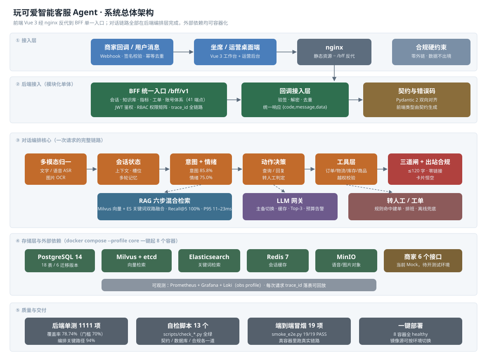
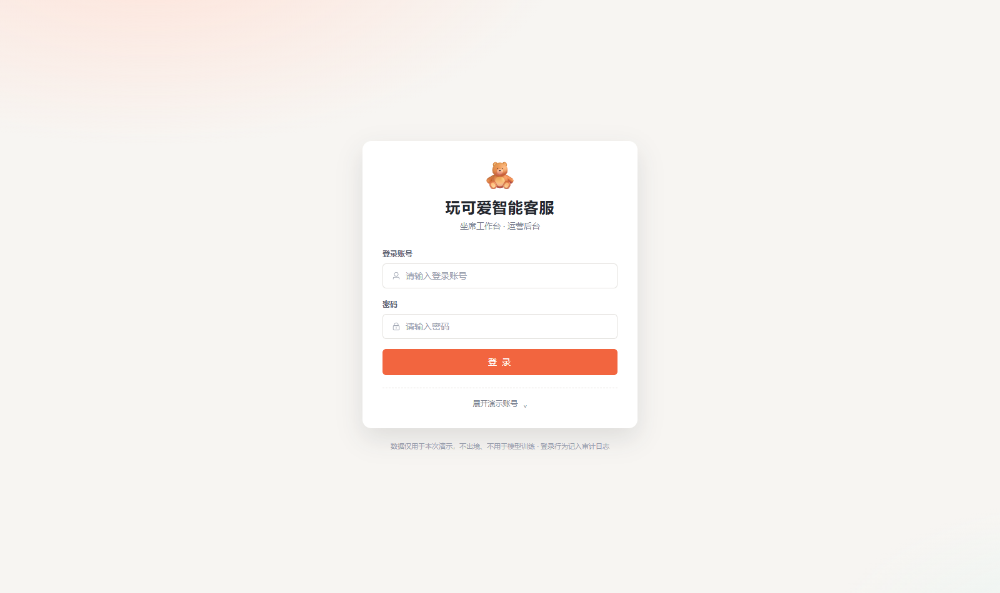
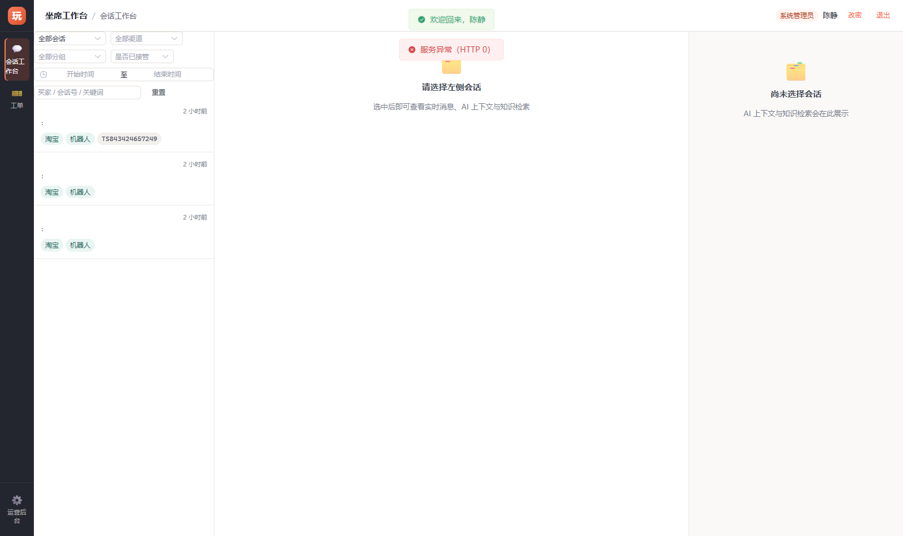
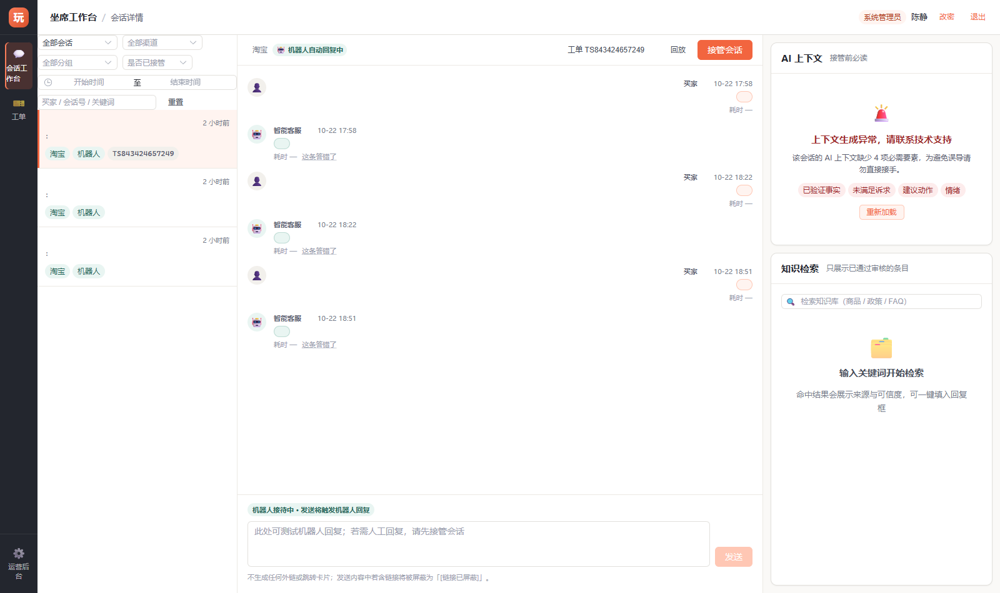
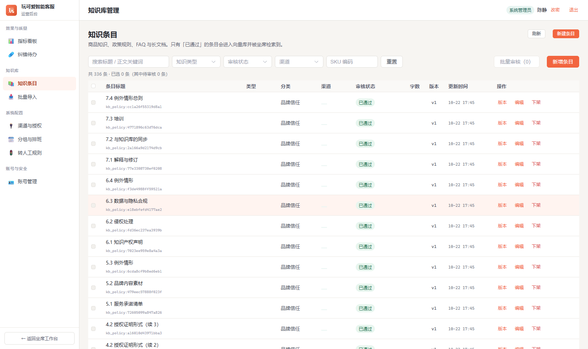
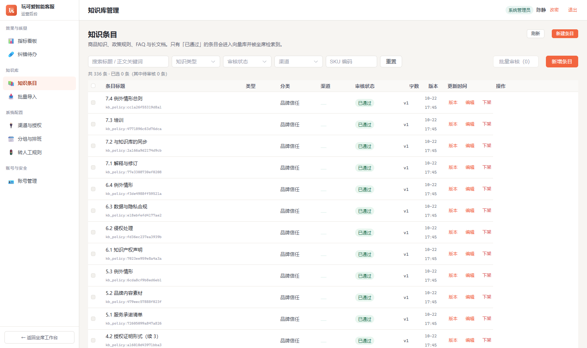
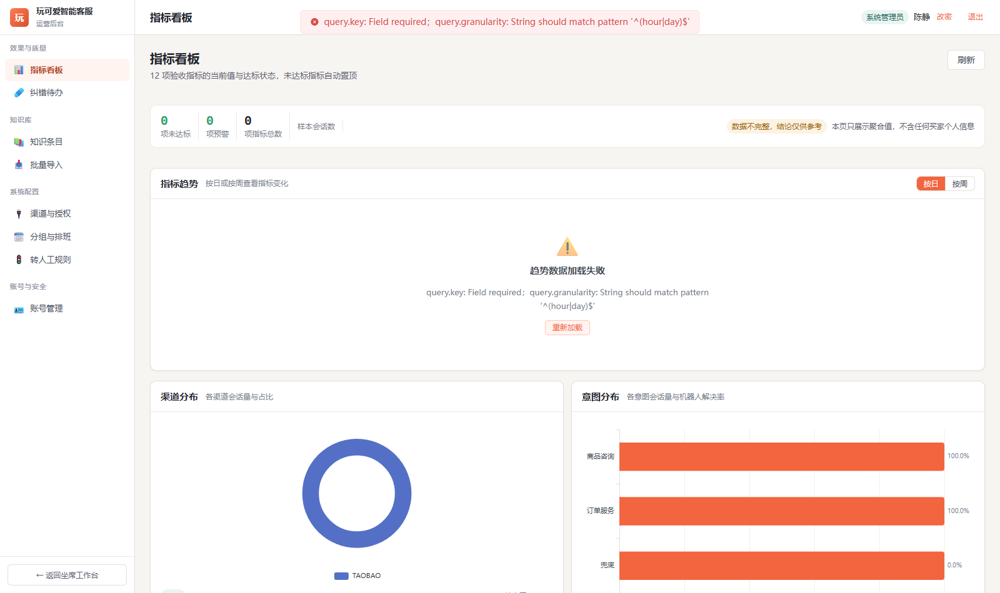
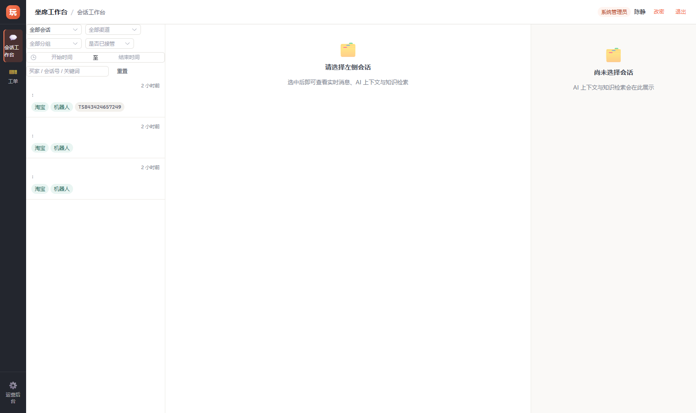
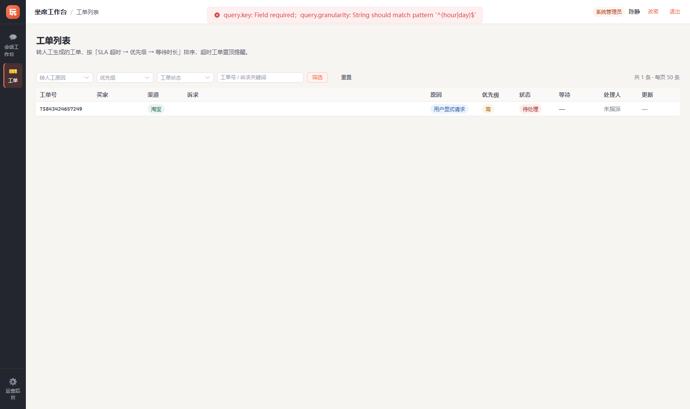

# 玩可爱智能客服 Agent

面向潮玩零售商家的**智能客服系统**：用户在会话里问订单、物流、商品与售后政策，Agent 自动查询业务系统、检索知识库并生成回复；遇到越权、投诉、要求转人工等情形，自动建单交给坐席接续。

- **后端**：Python 3.12 + FastAPI + SQLAlchemy 2.x + Pydantic 2，模块化单体
- **前端**：Vue 3 + TypeScript + Element Plus（坐席工作台 + 运营后台）
- **存储**：PostgreSQL 14 / Milvus / Elasticsearch / Redis / MinIO
- **部署**：`docker compose --profile core up -d` 一键起 8 个容器



> 需要 PNG 版（贴 PPT / 微信）：[docs/architecture.png](docs/architecture.png)

---

## 1. 一句话看懂链路

一条用户消息进来后，会依次经过：

```
回调接入 → 多模态归一（文字/语音/图片）→ 会话状态 → 意图+情绪
        → 动作决策 → 工具层(订单/物流/库存/商品) 或 RAG 六步检索
        → 三道闸 → 回复 → 出站合规闸 → 分段发送
```

其中 **出站合规闸** 是硬性要求，任何一条回复都必须满足：

| 约束 | 校验点 |
|---|---|
| HC-1 零外链 | 回复正文不得出现 http/https、跳转卡片、小程序唤起 |
| HC-2 数据合规 | 数据不出境、不用于训练、最小必要、可删除可追溯 |
| HC-3 会变的数字走接口 | 库存 / 价格 / 物流单号永远实时查接口，不进向量库 |

---

## 2. 三分钟把系统跑起来

### 2.1 前置条件

| 依赖 | 版本 | 说明 |
|---|---|---|
| Docker Desktop | 4.x 以上（Engine 25+） | 本机没有 Docker 时，先装好再执行 |
| 空闲端口 | 8080 / 8000 / 5433 / 6380 / 9201 / 19531 | 已与本机常见服务错开 |

### 2.2 启动

```bash
cd backend
cp .env.example .env          # 按需修改密钥、模型 Key
docker compose --profile core up -d
```

启动后（首次拉镜像约 5–15 分钟，之后秒起）：

| 入口 | 地址 |
|---|---|
| 前端（坐席工作台 / 运营后台） | http://127.0.0.1:8080/ |
| 后端 API 文档 | http://127.0.0.1:8000/docs |
| 健康检查 | `docker compose ps` 应看到 8 个容器全部 `healthy` |

### 2.3 验收自检

```bash
# 容器状态
docker compose --profile core ps

# 真实链路冒烟（登录 / 咨询 / 查物流 / 转人工 / 坐席台接口，共 19 项）
docker exec wkagent-app sh -c "cd /app && python scripts/smoke_e2e.py"
# 期望输出：结果：PASS 19 / FAIL 0
```

本地跑测试：

```bash
# 后端单元测试（1111 项）
cd backend && python -m pytest tests

# 前端类型检查 + 构建
cd frontend && npm run typecheck && npm run build
```

---

## 3. 界面截图

> 截图由 `frontend/scripts/shoot-deploy.mjs` 对**真实运行中的容器**拍摄，不是原型图。

### 3.1 登录

坐席与管理员共用入口，登录后按角色权限矩阵决定可见菜单。



### 3.2 坐席工作台

左侧会话列表按「待接入 / 进行中 / 已结束」分组，右侧是当前会话详情与转人工入口。



### 3.3 会话详情 + 接管

客服 Agent 已经在对话时，坐席可主动接管；接管后 Agent 自动停发，避免抢话。



### 3.4 知识库管理

商品知识 / 政策规则 / FAQ / 长文档四类条目，只有「已通过」的条目会进入向量库被检索到。



### 3.5 知识库批量导入

批量导入后逐条展示切分结果、类型判定与置信度，低置信条目转人工确认。



### 3.6 指标看板

会话量、转人工率、意图分布、回复时效等运营指标。



### 3.7 渠道授权

各渠道的接入状态与授权信息。



### 3.8 工单列表

转人工自动生成的工单，按队列顺序分配给在线坐席。



---

## 4. 目录结构

```
agent/
├── backend/                 # FastAPI 后端 + 全套 docker compose
│   ├── app/                 # 应用代码（api / services / adapters / models / core）
│   ├── alembic/             # 数据库迁移（6 个版本，upgrade/downgrade 双向往返）
│   ├── scripts/             # check_*.py 自检脚本 + smoke_e2e.py 端到端冒烟
│   ├── tests/               # 单元测试（1111 项）
│   ├── docker-compose.yml   # 8 容器一键编排
│   └── 交接文档.md           # 开发交接文档（含全部踩坑记录）
├── frontend/                # Vue 3 前端
│   ├── src/                 # 页面 / 组件 / 状态 / 权限矩阵
│   ├── mock/                # 本地 mock 服务（node:sqlite 无依赖）
│   ├── e2e/                 # Playwright 端到端用例
│   ├── deploy/              # nginx 配置（裸机与容器两套）
│   └── shots/               # 界面截图
├── 商家材料包/               # 商家提供的原始材料与接口说明
└── docs/                    # 架构图与项目级截图
```

---

## 5. 常见问题

**Q：拉镜像卡住 / 403？**
镜像源分三层，别混成一个变量：

| 层次 | 作用对象 | 变量 |
|---|---|---|
| 构建期 apt 源 | `apt-get update` | `APT_MIRROR` |
| 构建期 pip 源 | `pip install` | `PIP_INDEX_URL` |
| 运行期基础镜像 | python / node / nginx | `REGISTRY_MIRROR`（只作用于 docker.io） |
| 运行期业务镜像 | etcd / ES / MinIO | `ETCD_IMAGE` / `ES_IMAGE` / `MINIO_IMAGE` |

默认值都是国内可用地址；能直连官方仓库的环境把它改回官方地址即可。另：宿主机开系统代理时，镜像站会因判定「非大陆 IP」返回 403。

**Q：端口冲突？**
`backend/.env` 里的 `HOST_APP_PORT` / `HOST_POSTGRES_PORT` / `HOST_REDIS_PORT` / `HOST_ES_PORT` / `HOST_MILVUS_PORT` 都可在宿主机侧改。

**Q：`.env` 会不会被提交？**
不会。根目录与各子目录的 `.gitignore` 都把 `.env`、`*.pem`、`*.key` 排除在外，仓库里只有 `.env.example` 模板。

---

## 6. 文档索引

| 文档 | 内容 |
|---|---|
| [backend/交接文档.md](backend/交接文档.md) | 开发交接：模块说明、验收数据、**全部踩坑记录（含真机部署 13 项）** |
| [backend/docs/](backend/docs) | BFF 运维手册、偏差记录与修改计划书 |
| [商家材料包/docs/](商家材料包/docs) | 商家接口对接说明书 |

---

## 7. 许可

内部交付项目，未开放对外授权。
